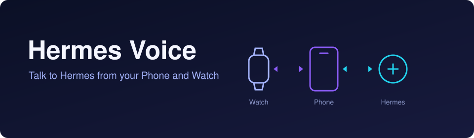

<div align="center">



# Hermes Voice

**Talk to your Hermes dashboard by voice or text, from an Android Phone and a Wear OS Watch.**

[](LICENSE)   

**English** · [한국어](README.ko.md)

[Features](#features) · [How it works](#how-it-works) · [Getting started](#getting-started) · [Headset mode](#headset-mode) · [Build and test](#build-and-test)

</div>

Hermes Voice is an experimental Android app with a Wear OS companion. The Phone signs in to a compatible [Hermes](#how-it-works) dashboard and manages the conversations the app creates. The Watch records on the watch itself, reads those conversations and plays replies, and it relies on the paired Phone to relay its requests to Hermes. It never connects to Hermes directly.

## Features

- **Text chat** with attachments (up to 6 per message, 10 MiB each) and paged conversation history.
- **Manual voice**: tap to toggle recording on the Phone, or use a one-second long press on the Watch. Speech is transcribed and spoken back using the speech providers configured on your dashboard.
- **Voice routing** (on by default, can be turned off): a spoken request is routed to one of your conversations by its voice alias, and the router may propose a new conversation. With routing off, requests go to the conversation selected on the sending device.
- **Optional hands-free use**: a wake phrase, listening in the background, and later replies. All are off by default.
- **Settings on both devices**: appearance, which replies are spoken, and the wake phrase and Watch options, which are set on the Phone and synced to the Watch.
- **Private headset output** with headset recording controls (off by default). See [Headset mode](#headset-mode).

## How it works

```text
Watch  ──Wear Data Layer──▶  Phone  ──HTTPS / WebSocket──▶  Hermes dashboard
(record, play, read)         (sign-in, conversations,        (STT, TTS, sessions)
                              voice routing)
```

- The Phone authenticates with the dashboard and calls its APIs directly. Each conversation is a dashboard session that the app created and lists only if it is in the Phone's local registry.
- The Watch exchanges messages only with its paired Phone, which relays its requests to Hermes. It stores no dashboard credentials and never connects to Hermes directly.
- Speech uses the dashboard's configured speech-to-text and text-to-speech. If a provider is unavailable or misconfigured, voice turns can fail.

## Getting started

1. Install the Phone and Watch builds. Both must use the same application ID (`com.rumi.hermesvoice`) **and** the same signing key, or the Data Layer will not deliver between them. See [Build and test](#build-and-test).
2. On the Phone, open **Settings** and enter your dashboard URL, for example `https://hermes.example.com/`. You can also enter a Hermes profile.
   - Use HTTPS. Plain HTTP is accepted only for loopback or Tailscale (`100.64.0.0/10`) addresses. URLs with embedded credentials are rejected.
3. Tap **Sign in**. The system browser opens the dashboard's own login page (a native-app flow with PKCE). The dashboard must support this flow. The app never sees your password and has no embedded passwords or API keys.
4. Create a conversation and give it a voice alias (lowercase letters, digits, `-` or `_`, up to 32 characters). Voice requests are routed only to these aliases.
5. Tap **Talk** on the Phone to start recording, and tap again (**Stop & send**) to send. On the Watch, press and hold still for one second anywhere on the main screen to start recording, then do the same again to stop and send. It is a toggle: releasing the press does not stop the recording.

The sign-in token is stored with an Android Keystore key, excluded from backup and device transfer, and bound to one dashboard URL and profile.

## Voice and the Watch

- **A voice turn.** The recording is checked for usable audio and transcribed on the dashboard. With routing on, the transcript goes to a hidden routing session that picks one of your conversations by alias, and the router must answer with a strict JSON object (anything else is refused). With routing off, it goes to the conversation selected on the sending device, and is refused if none is selected. Either way, the transcript is delivered to the conversation after a short spoken acknowledgement.
- **Where replies play.** By default, on the device that sent the latest accepted voice request. If that is the Watch and it cannot be reached, the reply is not played on the Phone instead. The exception is [Headset mode](#headset-mode) on the Phone, which routes spoken answers to the headset.
- **Watch reader.** The Watch shows your app-owned conversations. Swipe left to switch between the list and the open conversation, and swipe right or press Back to send the app to the background. It keeps at most 200 messages per conversation, and older ones are on the Phone.
- **Wake phrase** (off by default, set on the Phone). **Listen on** chooses Off, Watch, Phone or Both. Phrases are shared by both devices. By default it listens only while that device's app is open.
- **Background use** (all off by default). The Phone can keep listening with the app closed or the screen off, and the Watch can keep a background session. This needs an on-device speech recognizer, shows a notification with **Stop**, and starts only from the open app.

## Headset mode

**Use headset** is in the Phone's Settings and is **off by default**. It applies when it is on and a personal audio output (wired, USB or Bluetooth headphones or a headset) is currently connected to the Phone. Android cannot reliably distinguish some Bluetooth headsets from speakers or car audio, so enable this only for a headset you intend to use privately. With earbuds, check that they are worn and connected first; the app does not check wear sensors.

While it applies:

- **Answers play privately on the Phone.** Every spoken answer goes only to that headset: answers to requests spoken on the Phone or on the Watch, later replies, and answers to messages you type. Nothing plays on the Watch's speaker or the Phone's speaker, and the Watch is asked to stay silent. If the headset disconnects, the answer stops and is not moved to a speaker. The answer text remains available; notifications depend on Android settings. This does not lengthen how long a conversation is followed.
- **Headset buttons.** An accepted **PLAY** or **PAUSE** toggles the Phone's current recording: it starts one when idle and stops it while recording. A press delivered twice counts once.
- **Cues.** One private ding marks the start of a recording and two mark its stop. They play only on the headset and are not part of the recorded request.
- **Watch recording continues independently.** The Watch can still record and submit its own requests, and the Phone's headset mode does not turn that off. Its answers are played on the headset.

Caution: whether buttons work with the screen off or the app in the background depends on Android admitting the microphone foreground service and on the device's power policy, and another media app can take over the media button. A connected Bluetooth output alone does not show that its microphone is used for recording. No specific headset model is promised.

## Build and test

| Item | Version |
| --- | --- |
| JDK | 17 |
| Kotlin | 1.9.22 |
| Android Gradle Plugin | 8.13.2 |
| Gradle | 8.13, installed separately (**no Gradle wrapper**) |
| Android SDK | Platform 35 (`compileSdk` and `targetSdk` 35) |
| `minSdk` | Phone 29, Watch 30 |

Point Gradle at your Android SDK with `ANDROID_HOME` or an untracked `local.properties` containing `sdk.dir=...`. Then build both debug APKs:

```sh
gradle --no-daemon :phone:assembleDebug :watch:assembleDebug
```

Both are signed with your local debug keystore. They must use the same one for the Watch link to work. Dependencies resolve from Google Maven and Maven Central.

Run the pure-JVM core tests with Gradle:

```sh
gradle :core:test
```

Or without Gradle or the Android SDK, using `scripts/core-jvm-check.sh`. It needs `java`, `curl`, `python3` and `sha256sum`, and it checks every jar by SHA-256. It checks only `:core`.

```sh
# First run: FETCH=1 downloads kotlinc 1.9.22 and the pinned jars into the tools directory.
HERMES_VOICE_TOOLS="$HOME/.cache/hermes-voice-tools" FETCH=1 scripts/core-jvm-check.sh

# Later runs reuse the tools directory. Optional environment variables:
#   HERMES_VOICE_WORK=<dir>  build output directory (default: a new temporary directory)
#   TMPDIR=<dir>             temporary directory for the compiler and JVM
#   COMPILE_ONLY=1           compile the core without running the tests
HERMES_VOICE_TOOLS="$HOME/.cache/hermes-voice-tools" scripts/core-jvm-check.sh
```

The Phone and Watch UI tests run under Robolectric and need extra test dependencies. See [android-test-harness/README.md](android-test-harness/README.md). The [`verification/`](verification) directory holds source manifests and test-overlay patches for earlier snapshots.

## Repository structure

| Path | Contents |
| --- | --- |
| `core/` | Pure Kotlin/JVM library and its tests: sign-in, dashboard clients, sessions, chat, voice orchestration, settings, Phone↔Watch contract |
| `phone/` | Android app (Jetpack Compose): sign-in, conversations, chat, voice, settings, headset controls, Watch bridge. Has its own Android tests |
| `watch/` | Wear OS app (Compose for Wear OS): conversation reader, voice, optional wake phrase, playback. Has its own Android tests |
| `scripts/` | `core-jvm-check.sh`, the Gradle-free core check |
| `android-test-harness/` | Test-only Gradle additions for the Robolectric tests |
| `verification/` | Source manifests and test-overlay patches |
| `docs/assets/` | README artwork |

## Later replies

<details>
<summary>How optional later replies are played</summary>

**Speak later replies** is off by default. It is this phone's own consent, and a restored or transferred install starts with it off. While it is on, the app follows a conversation for a set time after a request is delivered and speaks each later assistant reply that arrives in that time. The follow time is set under **Follow for** and can be 1 minute to 3 days. It is 30 minutes by default.

- **Order and limits.** One later reply is prepared or played at a time, in arrival order: per
  followed request one being prepared or played plus 4 waiting, and at most 8 in all. Any more are reported as not played.
- **Where it plays.** On the device of the latest accepted voice request, or on the headset when [Headset mode](#headset-mode) applies. It waits while a voice request is in flight and while something records on the device it will play on. It does **not** wait for the other device: a reply may play on the Watch while the Phone records, or the other way around.
- **Start bound.** A reply may only **begin within 10 minutes of its arrival**, once the speaker is free and the target's microphone is not in use. If it cannot, it is reported as not played.
- **No total time limit.** After it begins, a reply is **not cut by
  a total time**. A long reply is split into pieces that are synthesized and played one after another. A failure, a disconnect, Stop or turning the option off ends it.
- **Power.** Each unit of speaking one piece asks Android to keep the CPU awake for at most 7 minutes 5 seconds, renewed per piece, and releases it when the unit ends. Waiting for the server to generate a piece's speech holds no CPU, microphone or audio focus.
- **When it is lost.** Nothing that arrives after the follow time is spoken. If the dashboard connection drops, later output is missed from then on. If Android ends the Phone app's process, everything waiting is lost. A reply to something sent from another Hermes client to the same conversation can also be spoken, because Hermes does not mark which request a reply belongs to.
- **When it stops.** Sending a new message to that conversation ends the follow. Turning the option off or pressing Stop on the background relay or background listening ends every follow and every waiting reply.

</details>

## Known limitations

- Development (debug) builds: no release signing or minification is configured.
- The Watch needs a paired Phone that runs this app. The Wear Data Layer needs Google Play services on both devices.
- Wake-phrase listening uses each device's platform speech recognizer, window after window. It is not a dedicated low-power hotword engine. Android may stop background listening, and battery use has not been measured.
- Background recording and listening need the app to be started from the foreground, and they stop after a force stop, a permission change or a device restart.
- The hands-free ending of a recording is based on loudness, not on understanding speech.
- Replies are matched to requests by order. The gateway sends no per-request ID.
- Hermes server-initiated requests, such as tool approvals, are not answered.
- Actual device behavior (screen off, Doze, hardware headsets, battery cost) has not been verified for every device.

## License

[MIT](LICENSE). Copyright (c) 2026 Junsung-Lee-coder.
